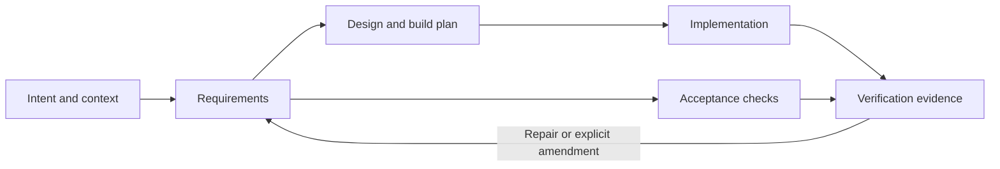

# BUILD.MD

**A build contract for AI-generated software.**

Give a coding agent one file that explains what to build, why it matters, what
it must preserve, how to proceed, and how to prove the result works.

BUILD.MD combines product intent, context, requirements, design boundaries,
execution prompts, and acceptance checks in a versioned Markdown document.
Keep it with the code and update it when the intended software changes.

**Status: v0.1 proposal.** Ready to try and improve; not an adopted industry
standard. No particular agent, model, framework, or installer is required.

[Start with the small example](examples/word-count/BUILD.MD) ·
[Copy the comprehensive template](BUILD.MD) · [Read the specification](SPEC.md) ·
[Research and rationale](docs/research.md)

## Start with one file

1. Copy [BUILD.MD](BUILD.MD) into your application repository. It is a template;
   replace its placeholders, choose a project ID, and remove its template notice.
2. Describe the desired outcome and non-goals. Define observable requirements and
   acceptance checks before implementation. Keep ordinary design choices delegated.
3. Resolve blocking questions and mark the contract `ready`.
4. Give your coding agent the prompt below and the file. Review its evidence when
   it finishes, then keep the contract aligned with subsequent changes.

```text
Read BUILD.MD as the build contract for this task, along with applicable
repository instructions. Follow its Agent prompts within the current user
authorization and host permissions. Inspect the starting state, resolve delegated
choices, and implement the stated scope. Surface material blockers while continuing
independent work. Verify every acceptance check and deliver the requested artifacts
with actual results, evidence, and any remaining limitations.
```

You can start from a rough idea instead:

```text
Use the BUILD.MD template to turn the following idea into a build contract:
[describe the idea]. Research necessary context, distinguish facts from assumptions,
and define observable requirements and acceptance checks. Make ordinary design
choices explicit. Ask only for material missing product decisions. Review for
contradictions and missing inputs, then refine the draft. Do not claim that the
application is implemented merely because the contract is ready.
```

See [authoring and review](docs/authoring.md) for existing applications, references,
AI features, and changing a contract.

## How it fits

| File | Primary purpose |
| --- | --- |
| `README.md` | Explain the project to people. |
| [`AGENTS.md`](https://agents.md/) | Give agents repository working instructions and conventions. |
| [`SKILL.md`](https://agentskills.io/specification) | Package a reusable agent capability with instructions and resources. |
| `BUILD.MD` | Specify this application's intended outcome, build workflow, and acceptance contract. |

These purposes can overlap. BUILD.MD complements existing conventions; it does
not override their instructions or the user's authorization. The Agent Skills
filename is `SKILL.md`, singular.

Agents do not necessarily auto-load BUILD.MD. Pass its path explicitly, or add a
pointer in your existing instructions using the [integration guide](docs/integration.md).
If your repo already has `BUILD.md`, preserve it and use a non-conflicting path.
Case-only filenames are not portable.

## What goes inside

| Section | Question it answers |
| --- | --- |
| Intent | Who needs this, and what should improve? |
| Scope | What is included, excluded, and delivered? |
| Context | What must the builder know or have access to? |
| Requirements | What behavior and constraints are binding? |
| Design | What is fixed, and what may the builder decide? |
| Build plan | How will the work be sequenced, run, and packaged? |
| Verification | What observations establish acceptance? |
| Agent prompts | How should the agent build, review, resume, and amend? |
| Decisions | What is assumed, unresolved, or deliberately chosen? |
| Delivery | What artifacts and evidence complete the work? |

Small projects can use a few lines per section. Large projects can name precise
supporting assets while retaining core intent and acceptance in the file.



The document is a living contract. A task list, generated test, or agent's summary
is not proof of completion. Verification must address the intended behavior.

## Optional validation

The file works without tooling. This repo includes a Python 3.9+ standard-library
linter that checks metadata, section structure, stable IDs, and requirement
coverage. It never executes commands embedded in documents.

From this repository root:

```sh
python3 scripts/lint_build.py BUILD.MD
python3 scripts/lint_build.py --ready examples/word-count/BUILD.MD examples/reading-list/BUILD.MD
python3 -m unittest discover -s tests -v
```

To check your own file, pass its path to the script. `--ready` requires ready
status; ready documents cannot retain template markers. Success means **structure
valid**, not that the contract is complete, the software works, or publication is
authorized. See the [validator boundary](SPEC.md#11-reference-validator-boundary).

## Repository guide

- [SPEC.md](SPEC.md): normative v0.1 format and behavior.
- [BUILD.MD](BUILD.MD): complete copyable template with embedded prompts.
- [Examples](examples/README.md): compact CLI and browser application contracts.
- [Authoring](docs/authoring.md): how to write and review a useful contract.
- [Integration](docs/integration.md): explicit loading and existing workflows.
- [Build report template](docs/build-report-template.md): actual results and handoff.
- [Research](docs/research.md): primary sources and design tradeoffs.
- [Proposal review](docs/proposal-review.md): critique and resulting improvements.
- [Validation](docs/validation.md): checks performed and their limits.
- [Contributing](CONTRIBUTING.md): changes, trials, and versioning.
- [Changelog](CHANGELOG.md) and [MIT license](LICENSE).

The example applications are specifications, not shipped implementations.
Independent build trials are the next step in evaluating the format's usefulness.
